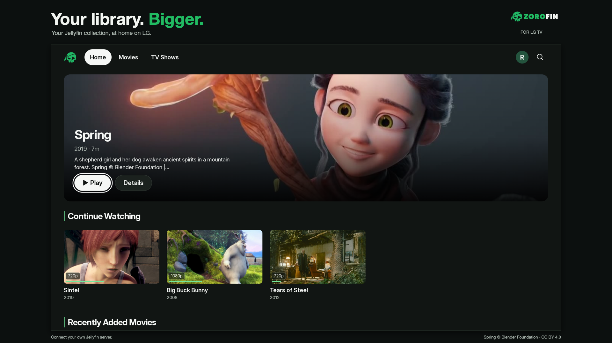
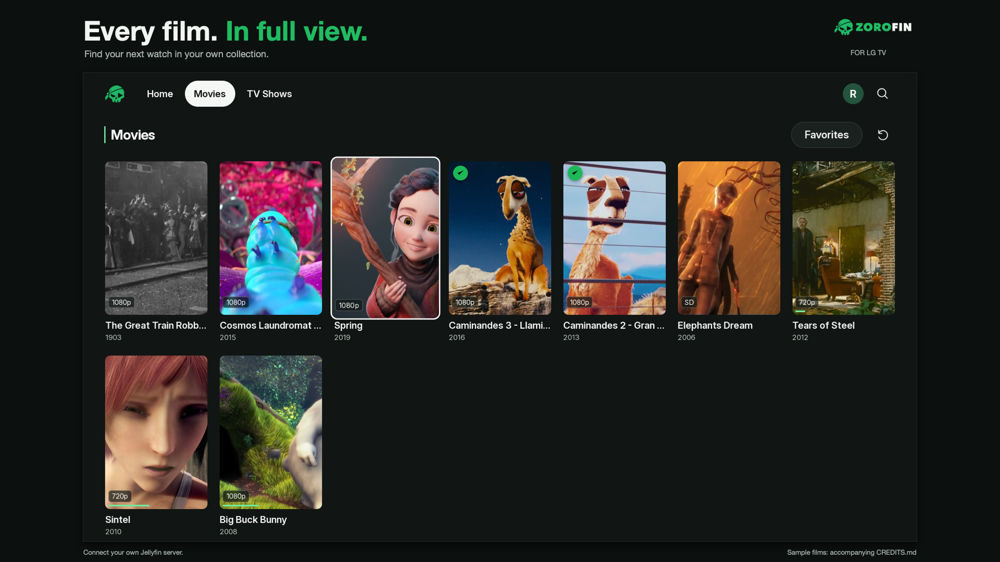
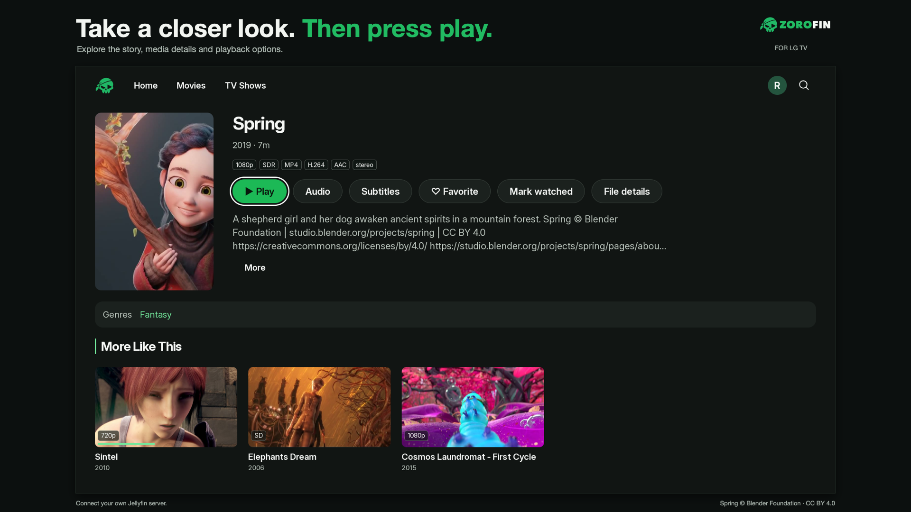
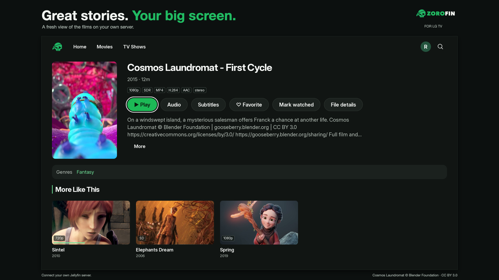

# Zorofin for LG webOS

Your Jellyfin library, on your LG TV.

[Download LG 1.4.0](https://github.com/Zoraz01/zorofin-lg-releases/releases/tag/lg-v1.4.0) · [Installation](INSTALL.md) · [Zorofin](https://zorofin.app) · [Credits](CREDITS.md)

This repository distributes the LG application and release metadata. It contains no application source or media. You supply your own Jellyfin server. The app does not require root.

Zorofin works with ordinary Jellyfin servers. Compatible optional Zorofin plugin/Companion modules can add Home rows, server guide enrichment and email/ntfy ready alerts; module availability and setup are separate.

The owner tested and reviewed the 1.4 baseline on LG B5/webOS 25. The published package adds a Catch Up focus fix validated by 134 DOM tests; a separate physical retest of that corrected package is not claimed. Other models, older releases, Homebrew/rooted installs and cross-store updates have separate acceptance gates. See [release notes](RELEASE_NOTES.md). LG Store QA and webOSbrew catalog acceptance are independent.

The images are historical 1.2.0 reference captures of the permitted nine-film sample library on an actual LG TV; they are not new 1.4 screenshots. Their QA app identity and production-code equality are documented in [provenance](SCREENSHOT_PROVENANCE.json).
